 

Sakura is a Discord bot you set up your way. Start with `$setup` to pick your welcome flow, roles, tickets, logs, voice rooms and moderation tools. `$help` is always there.

I started from the base of a popular all-in-one bot, changed parts of it, and added my own features and look. This page covers the bot and its design, not its source code.

**Sakura is not public.** To add her to your server, message **`meatforlove`** on Discord.

## The look 見た目

| Avatar | Profile banner |
| --- | --- |
|  |  |

Blossoms, a dark night sky, and an edge. Server owners can pick their own accent color for supported bot panels.

## What Sakura can do 機能

- **Set up a server:** build roles and channels, configure welcome messages, verification, rules and automatic join roles.
- **Give members a place:** color and ping roles, temporary voice rooms, levels, ranks and giveaways.
- **Handle tickets:** support and purchase ticket panels with staff replies and separate archives. Members get a private transcript link when a ticket closes.
- **Keep order:** moderation commands, a server guard, configurable event logs and Discord AutoMod event logs. Staff can turn on Sakura's spam-blocking AutoMod rule with `/automod enable`.
- **Stay in control:** the private Control Room for server settings, ticket work, bot presence and voice controls.

Features depend on the bot's permissions in each server. The Control Room is private and is not in this repository.

## A look inside 中身

These previews use the real Control Room layout with made-up sample data. Some older preview art still uses the former 07 name.

| Overview | Welcome and setup |
| --- | --- |
|  |  |

| Ticket desk | Server guard |
| --- | --- |
|  |  |

## Add Sakura 依頼

Sakura is set up by hand for each server. Message **`meatforlove`** on Discord.

This repository holds artwork, descriptions and sample previews only. The bot and its private sites are not published here.

